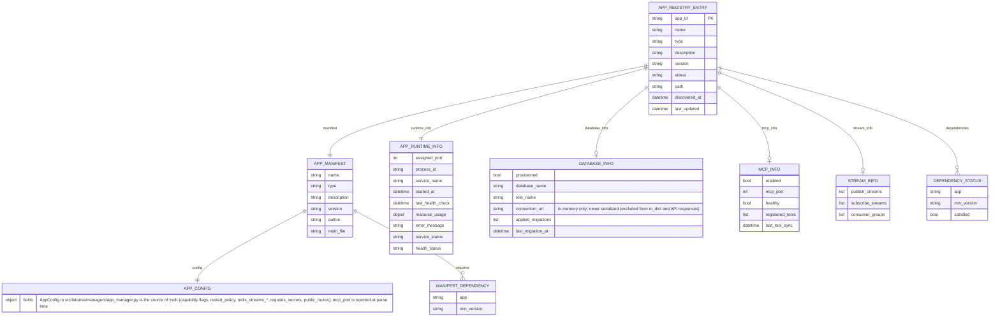
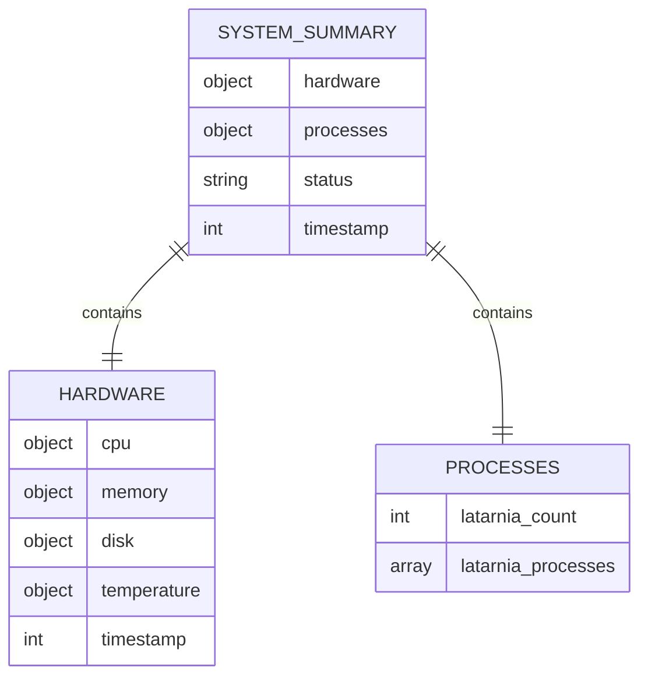
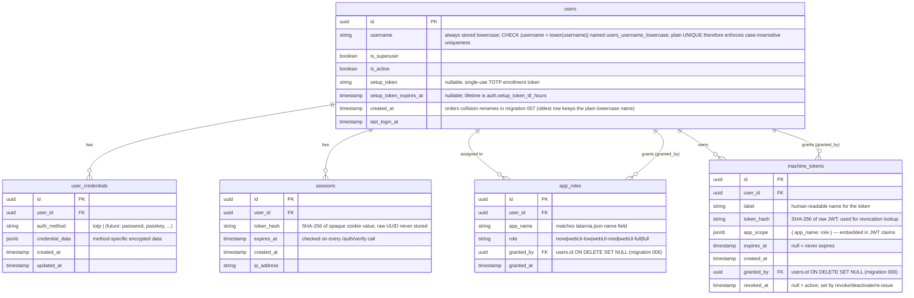
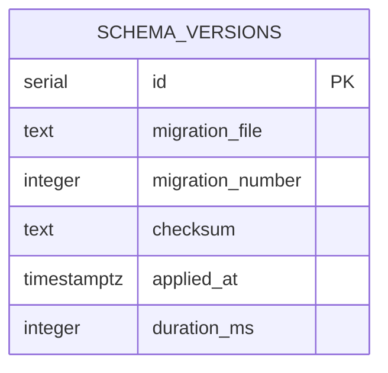
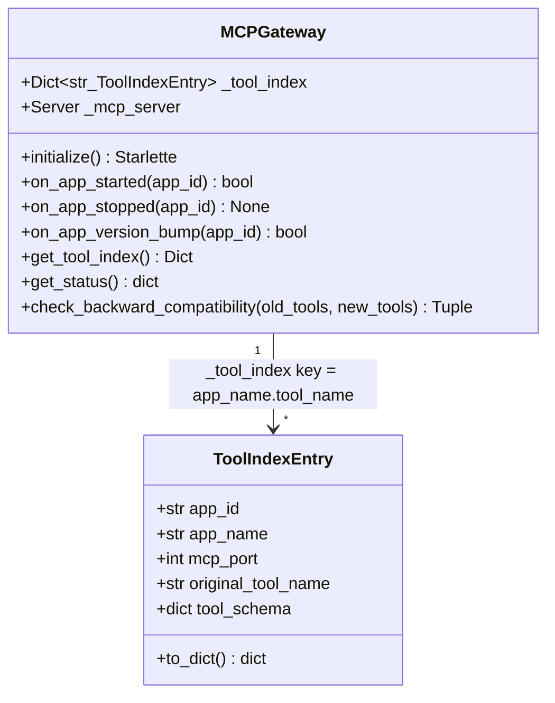

# Latarnia Database Schema

This document describes the data storage and persistence strategy for the Latarnia platform.

## Storage Strategy

- **Configuration**: JSON file (`config/config.json`) plus `LATARNIA_*` environment overrides, validated by pydantic models
- **Platform auth state**: Postgres database `latarnia_platform_{env}` (users, sessions, roles, machine tokens)
- **App data**: one Postgres database per App that declares `database: true`, plus file-based storage per App (`data/{app_id}/`)
- **App Registry**: in memory only; rebuilt from the `apps/` folders by `discover_apps()` on every start
- **Redis Streams**: between Apps, plus one capped list for the dashboard activity feed
- **Logs**: journald for Service Apps on Linux, plain files elsewhere (see Logs below)

## Data Models

### Configuration Schema

The platform settings are the pydantic models in `src/latarnia/core/config.py` (`LatarniaConfig` and the models it contains: Redis, Postgres, process manager and port ranges, system, MCP gateway, auth, event subscriber, logging). That file is the source of truth for fields, defaults and units; `config/config.example.json` shows the JSON layout. Not copied here.

### App Registry Schema

The registry entry (`AppRegistryEntry`) was extended in P-0002 with capability sub-objects for database, MCP, and stream state. All fields are optional — apps that do not declare a capability have `null` for that info block.



### System Metrics Schema

System metrics are computed on request and never stored. `GET /api/system/metrics` returns `SystemMonitor.get_system_summary()` (`src/latarnia/utils/system_monitor.py`); the field lists of each part are defined there, not copied here. Redis status is a separate endpoint, `GET /api/system/redis`, served by the Redis monitor (not part of the summary); Postgres connectivity is `GET /api/system/postgres`.



### Platform Auth Database Schema

The platform owns a separate Postgres database — `latarnia_platform_{env}` (e.g., `latarnia_platform_dev`, `latarnia_platform_tst`, `latarnia_platform_prd`) — created and migrated by `AuthDB` (`src/latarnia/auth/db.py`) at Latarnia startup. This DB is **distinct from the per-app databases** provisioned by the DB Provisioner; it uses the platform's admin credentials and is never passed to App processes.

Five tables live in this database. Migrations are in the `src/latarnia/auth/migrations/` directory and applied via the same sequential runner + `schema_versions` pattern used by the DB Provisioner.



**Key field notes:**
- `users.username`: normalization happens at a single boundary — `normalize_username()` in `src/latarnia/auth/users.py`, called from both `UserStore.create_user` and `UserStore.get_user_by_username`. Every read and every write is folded to lowercase there, so `routes.py` and `USERNAME_RE` are unchanged; mixed-case input is normalized rather than rejected.
- `user_credentials.credential_data`: for TOTP, contains `{"totp_secret_enc": "<base64-nonce+ciphertext>", "last_totp_window": <int>}` (`last_totp_window` is the last accepted TOTP time window, for replay protection). The TOTP secret is encrypted with AES-256-GCM using `LATARNIA_TOTP_ENC_KEY` from `secrets.env`. Nonce is prepended to ciphertext.
- `sessions.token_hash`: cookie value is a random UUIDv4 never persisted; only its SHA-256 hash is stored.
- `app_roles.role` enum: `none`, `webUI-low`, `webUI-med`, `webUI-full`, `full`. Default effective role when no row exists: `none`. `full` is the only role granting REST API access.
- `machine_tokens`: JWT claims carry `sub` (user_id), `iat`, `jti` (random, unique per token so `token_hash` never collides — T-0022), `exp`, `apps` (copy of `app_scope`), `super` (bool). Revocation check is a DB lookup on every API call. `revoked_at` is set on individual revocation, on user deactivation (`deactivate_user`), and on re-issue (`reissue_setup_token`); reactivation does NOT clear it.
- `app_roles.granted_by` and `machine_tokens.granted_by`: `ON DELETE SET NULL` (migration 006) — rows survive the deletion of the granting Superuser with `granted_by = NULL`.

### Postgres Per-App Database Schema

Each app with `database: true` receives its own Postgres database and role. Names are built by `DbProvisioner._generate_names` in `src/latarnia/managers/db_provisioner.py` from `postgres.database_prefix` / `postgres.role_prefix` and the App name (`-` mapped to `_`, lowercased). The platform creates the following tracking table in every provisioned database.

**Platform-default extensions:** Every Latarnia-provisioned app DB has the extensions in `db_provisioner.DEFAULT_EXTENSIONS` enabled by the platform at provisioning time. Apps do NOT need a `CREATE EXTENSION` migration for those — the per-app role doesn't have privilege anyway. Check the source for the current list.



Migration files are named with a numeric prefix (e.g., `001_initial.sql`, `002_add_tags.sql`). The platform runs only migrations whose `migration_file` is not already recorded in `schema_versions`.

### MCP Gateway In-Memory Model

The MCP gateway maintains an in-memory tool index. This model is not persisted to disk between restarts; it is rebuilt from running apps on startup.



Tool index key format: `"{app_name}.{tool_name}"` — no nesting beyond one level.

## File System Structure

Paths are env-scoped (P-0004): the same Pi runs `tst` and `prd` side-by-side under `/opt/latarnia/{env}/` with no shared mutable state.

### Per-environment layout
```
/opt/latarnia/{env}/                   # env ∈ {tst, prd}
├── .venv/                             # Python venv (one per env, used by main + per-app units)
├── src/                               # Platform source (git checkout)
├── apps/                              # Discovered apps (deploy-time copy of examples/, plus real apps in PRD)
│   └── {app_id}/
│       ├── latarnia.json
│       ├── app.py
│       ├── requirements.txt
│       └── migrations/                # Optional, for apps with database: true
├── data/
│   └── {app_id}/                      # Per-app data dir; passed via --data-dir
├── logs/
│   └── {app_id}.log                   # macOS dev only (SubprocessLauncher Popen redirect)
│   └── {app_id}-streamlit.log         # Streamlit apps (per-streamlit subprocess redirect)
├── secrets.env                        # Master secret store (operator-edited, mode 600). NEW in P-0006.
└── secrets/                           # Per-app filtered files (platform-managed, mode 700). NEW in P-0006.
    └── {app_id}.env                   # Mode 600. Contains only keys this app declared in requires_secrets.
```

### Per-user systemd state (Linux only)
```
~{user}/.config/systemd/user/             # home of the user running the platform
├── latarnia-tst-{app_id}.service      # Generated at runtime by ServiceManager
└── latarnia-prd-{app_id}.service
```

### Platform main-unit (system-scope)
```
/etc/systemd/system/
├── latarnia-tst.service               # Installed once at bootstrap (see deployment skill)
└── latarnia-prd.service
```

### Logs

- **Service apps on Linux**: stdout/stderr → systemd journal (queryable with `journalctl _SYSTEMD_USER_UNIT=latarnia-{env}-{app_id}.service`). No per-app log files on disk.
- **Service apps on macOS dev**: stdout/stderr → `logs/{app_id}.log` (SubprocessLauncher Popen redirect).
- **Streamlit apps (any OS)**: stdout/stderr → `logs/{app_id}-streamlit.log` (StreamlitManager Popen redirect).
- **Platform main process**: stdout/stderr plus a plain `FileHandler` on `latarnia-main.log` under `logs/` (set up in `main.py`; no rotation).

### Registry

There is **no on-disk registry** (no `registry/` directory, no JSON persistence). `AppRegistry` is rebuilt on every platform start by `discover_apps()` scanning `apps/`, plus reconciliation against any surviving `latarnia-{env}-*.service` user units (P-0005 Scope 4). Port allocations are also in-memory only.

## Redis Data Structures

### Redis Keys in use

```
latarnia:streams:{declared_name}   # App-to-App streams (see below)
latarnia:events:recent             # Capped list: latest stream messages for the dashboard activity feed
```

No other keys are written by the platform. The platform neither publishes nor subscribes to pub/sub channels (leftover pub/sub code — `RedisMessageBusClient`, `event_subscriber.channels`, and `example_full_app` publishing to `latarnia:events:app` — is unused and tracked by T-0029), no cached registry or config, no metrics in Redis, and no lifecycle events (App started/stopped) are published. The App Registry and port allocations are in memory.

### Redis Streams

Apps that declare `redis_streams_publish` or `redis_streams_subscribe` in their manifest have streams and consumer groups provisioned by the platform at discovery time.

```
latarnia:streams:{declared_name}   # Stream key (e.g. latarnia:streams:crm.contacts.created)
```

- **Publishers**: one owner per stream (collision causes registration failure). The platform records stream ownership in `StreamManager._publisher_map` (in-memory).
- **Subscribers**: one consumer group per subscribing app, named `{app_id}` within the stream. Tracked in `StreamManager._subscriber_groups`.
- **App usage**: apps `XADD` to their publish streams and `XREADGROUP` / `XACK` from their subscribe consumer groups using a Redis connection they manage themselves.

### Activity Feed Record

`AsyncStreamConsumer` (`src/latarnia/core/event_subscriber.py`) reads every `latarnia:streams:*` stream as consumer group `latarnia-dashboard` and pushes one JSON record per message onto `latarnia:events:recent`, trimmed to `event_subscriber.max_events`:

```json
{
  "source": "publishing app or stream name",
  "timestamp": 1700000000,
  "stream": "latarnia:streams:crm.contacts.created",
  "stream_id": "1700000000000-0",
  "data": {}
}
```

## Data Persistence Patterns

### Configuration Management
- **Primary**: JSON file (`config/config.json`)
- **Environment**: Override via `LATARNIA_*` variables
- **Validation**: Pydantic models with type checking

### App Registry Management
- **Storage**: in-memory dictionary (`AppRegistry`), never written to disk
- **Recovery**: rebuilt by `discover_apps()` on startup, then reconciled against surviving systemd units

### System Metrics
- **Collection**: on demand via psutil (`SystemMonitor`)
- **Storage**: none; nothing is kept in Redis or on disk (manual refresh pattern)
- **Export**: on-demand JSON API

### Log Management
- **Platform log**: plain `FileHandler` (`latarnia-main.log`) plus stdout, no rotation
- **Service Apps on Linux**: journald; elsewhere a redirect file per App (see Logs above)
- **Access**: `GET /api/apps/{id}/logs` reads the relevant source

## Data Migration Strategy

- Platform auth DB: sequential SQL migrations in `src/latarnia/auth/migrations/`, applied at startup.
- Per-App databases: the App's own `migrations/*.sql`, applied by the DB Provisioner.
- Configuration is not versioned; unknown keys are the pydantic model's concern.

## Performance Considerations

- The App Registry is a small in-memory dictionary.
- The activity feed list is capped by `event_subscriber.max_events`.
- Metrics are computed per request and not stored.
- App data is unlimited and per-App responsibility.

## Backup and Recovery

There is no automatic backup loop today. App registry and port allocations are in-memory and rebuilt on platform start (no backup needed). What's worth backing up:

| Source | Notes |
|---|---|
| **Per-env `data/{app_id}/`** | App-managed persistent state (manifest sets `data_dir: true`). Single rsync target per env. |
| **`latarnia_platform_{env}`** | Platform auth DB (users, sessions, app_roles, machine_tokens, user_credentials). Owned by the platform; not app-specific. `pg_dump latarnia_platform_{env}`. |
| **Postgres per-app DBs** | Provisioned by `db_provisioner.py`; one DB per app that declares `database: true`. `pg_dump` per DB; the registry knows the DB names. |
| **Redis** | RDB / AOF as configured on the host. The platform doesn't manage Redis lifecycle. |
| **`/etc/systemd/system/latarnia-{env}.service`** | Bootstrap artefact, installed manually per host. Not env-data. |

A platform-managed centralized backup loop (per-app data + per-app DBs, driven by the manifest) is a candidate for a future scope; nothing automates it today.

### Manual Backup Procedures
```bash
# Per-env app data (rsync target)
rsync -a /opt/latarnia/{env}/data/ /backup/{env}-data-$(date +%Y%m%d)/

# Per-app Postgres dump (one DB per app with database:true; name from db_provisioner._generate_names)
pg_dump -h localhost -U superuser {app_database} > /backup/{env}-{app_id}-$(date +%Y%m%d).sql

# Redis (host-level, both envs share the same instance)
redis-cli BGSAVE
cp /var/lib/redis/dump.rdb /backup/redis-$(date +%Y%m%d).rdb
```

### Recovery Procedures
1. `sudo systemctl stop latarnia-{env}.service`
2. Restore the per-env `data/` directory.
3. Restore per-app Postgres DBs (`psql ... < dump.sql`).
4. `sudo systemctl start latarnia-{env}.service` — discovery + reconciliation runs automatically.
5. Verify app discovery and status
