# Latarnia Workflows

This document covers the main process flows and interaction patterns in Latarnia. For component architecture and lifecycle sequence diagrams, see [architecture.md](architecture.md).

## 1. Application Startup

What happens when the Latarnia main application starts and stops (the `lifespan` function in `main.py`; the code is the source of truth for the order).

```mermaid
flowchart TD
    Start([FastAPI Lifespan Start]) --> CreateDirs[Create data/ and logs/ directories]
    CreateDirs --> SetupLog[Setup logging]
    SetupLog --> CheckRedis{Redis running?}

    CheckRedis -- Yes --> CheckPg
    CheckRedis -- No --> AutoStart[Attempt to start Redis<br/>via brew/systemctl]
    AutoStart --> CheckPg[Check Postgres connectivity<br/>log warning if unreachable]

    CheckPg --> AuthDb{Postgres reachable?}
    AuthDb -- Yes --> InitAuth[Create + migrate<br/>latarnia_platform_env DB]
    AuthDb -- No --> SkipAuth[Skip auth DB init, log warning]
    InitAuth --> Secrets[Check LATARNIA_TOTP_ENC_KEY and<br/>LATARNIA_JWT_SECRET, log error if missing]
    SkipAuth --> Secrets

    Secrets --> Linger{Linux and linger disabled?}
    Linger -- Yes --> WarnLinger[WARNING: sudo loginctl enable-linger]
    Linger -- No --> Discover
    WarnLinger --> Discover

    Discover[AppManager.discover_apps<br/>scan ./apps/, see section 2] --> Orphans[Clean up orphaned Apps<br/>whose folder was deleted]
    Orphans --> Reconcile[ServiceManager.reconcile_running_units<br/>claim ports, mark surviving units RUNNING]
    Reconcile --> Loop{Next Service App<br/>with auto_start = true?}

    Loop -- Yes --> Skip{Already RUNNING, or declared<br/>Redis/Postgres unreachable?}
    Skip -- Yes --> Loop
    Skip -- No --> StartApp[pick_launcher then<br/>launcher.start_service]
    StartApp --> Loop

    Loop -- No --> Mcp[Initialize MCP Gateway and mount it,<br/>sync tools of running MCP Apps]
    Mcp --> Caddy[Generate Caddyfile include and reload Caddy<br/>failure logged, not fatal]
    Caddy --> StartSub[Start AsyncStreamConsumer<br/>for the activity feed]
    StartSub --> StartHealth[Start HealthMonitor loop]
    StartHealth --> Ready([Application Ready])

    Ready -.-> Shutdown([Shutdown Signal])
    Shutdown --> StopHealth[Stop HealthMonitor]
    StopHealth --> StopSub[Stop AsyncStreamConsumer]
    StopSub --> StopSvc[SubprocessLauncher.stop_all]
    StopSvc --> StopStreamlit[StreamlitManager.stop_all]
    StopStreamlit --> Done([Shutdown Complete])
```

Per-App systemd units have independent lifetimes, so they are not stopped at shutdown; `reconcile_running_units` re-adopts them on the next start.

## 2. App Installation and Discovery

Decision logic when the App Manager scans the `./apps/` directory (`AppManager.discover_apps`). Discovery only **registers** an App in the in-memory App Registry; ports, dependency installation and `setup_commands` happen later in `prepare_app` (`POST /api/apps/{id}/prepare`). The registry is not persisted: it is rebuilt from the `apps/` folders on every start.

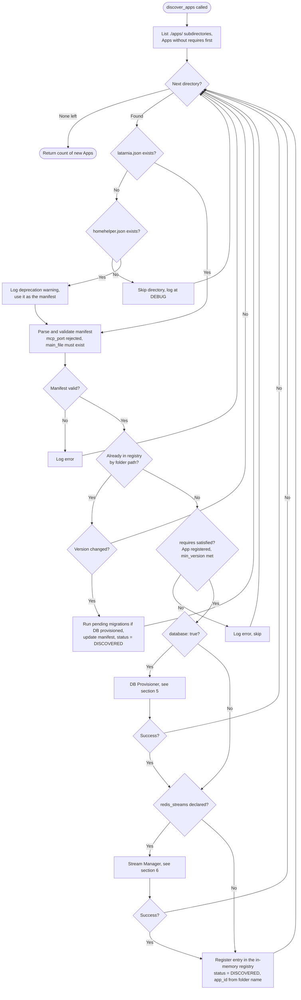

## 3. Dashboard UI Interaction

How a user navigates the web dashboard and interacts with apps through modals.

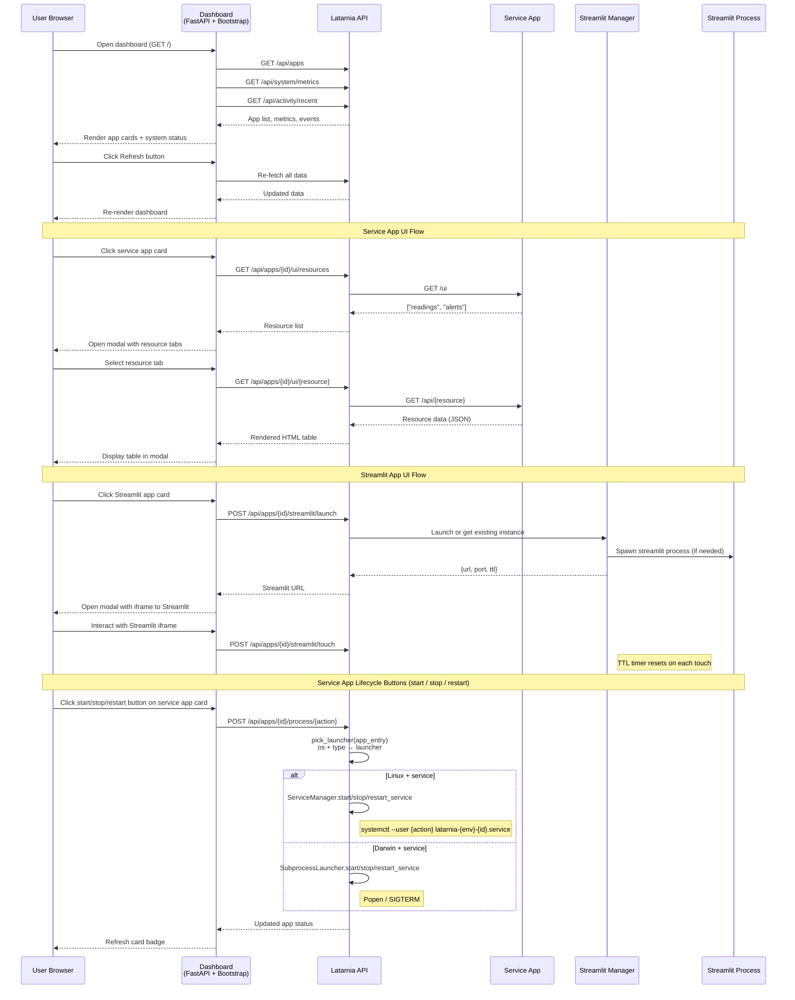

## 4. Health Check Monitoring

How the HealthMonitor periodically checks Service App health and handles failures. Interval, timeout, `failure_threshold`, `max_failures` and `startup_grace_period` are the `HealthCheckConfig` defaults in `src/latarnia/managers/health_monitor.py`.

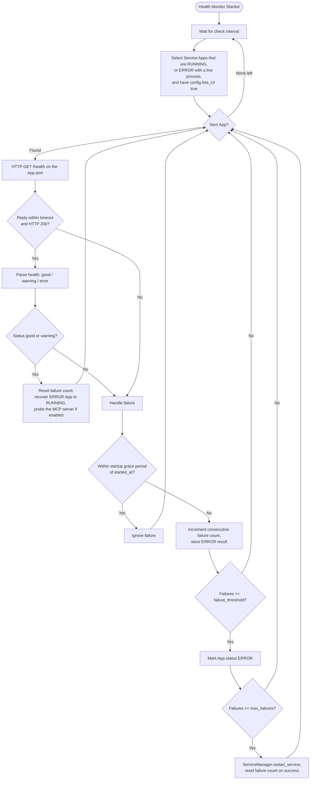

A `warning` health status counts as success. Per-App restarts after repeated failures are done by the HealthMonitor through `ServiceManager.restart_service`; systemd's `Restart=on-failure` covers process crashes independently.

**Known limitation:** the HealthMonitor currently selects only Service Apps whose manifest sets `config.has_UI: true` (`_perform_health_checks` in `health_monitor.py`). Service Apps without a UI are not probed: no automatic restart on failed health and no MCP liveness probe. A follow-up task will fix this.

## 5. Database Provisioning and Migration

How the DB Provisioner creates a per-app Postgres database and executes pending migrations (`DbProvisioner.provision_database`). Called during App discovery when `database: true`. References cap-003 and cap-004 in P-0002. The database and role names come from `db_provisioner._generate_names` (`postgres.database_prefix` / `postgres.role_prefix` in config, with `-` in the App name mapped to `_`).

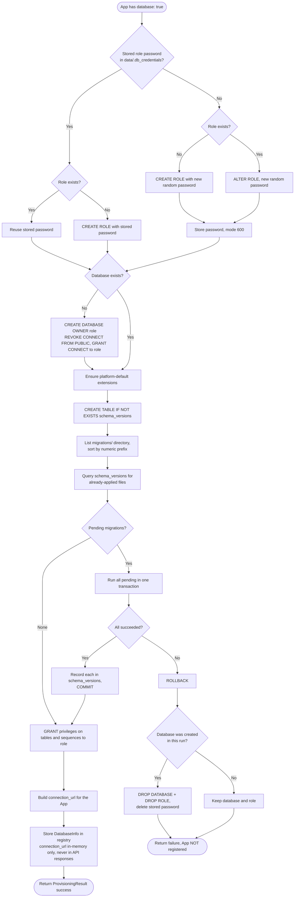

## 6. Redis Streams Setup

How the Stream Manager sets up streams and consumer groups during App discovery. Called after DB provisioning (if any). References cap-007 in P-0002.

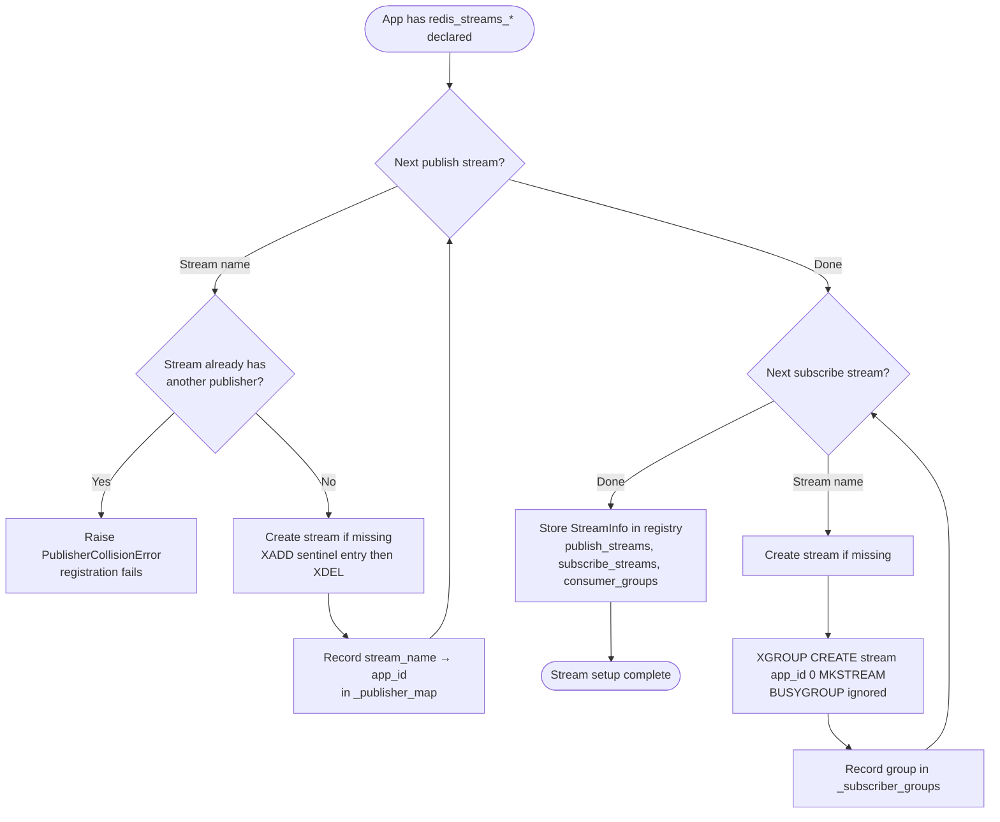

The consumer group starts at id `0`, so a new subscriber also receives entries already in the stream. On App **unregistration**, the Stream Manager calls `cleanup_app(app_id)`:
- Removes all consumer groups owned by the App from their streams.
- Releases the App's publisher ownership entries from `_publisher_map`.
- Does NOT delete streams — other consumers may still be reading from them.

## 7. MCP Gateway — Tool Discovery and Routing

How the MCP gateway aggregates tools from all MCP-enabled apps at startup and routes tool calls from external clients. References cap-006 and flow-05 in P-0002.

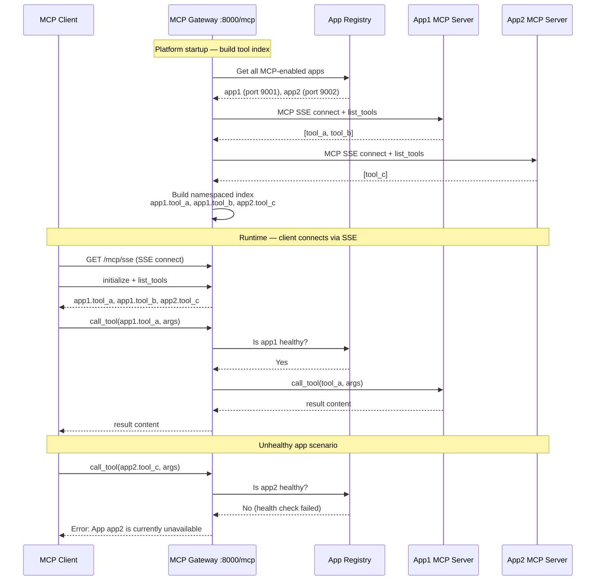

## 8. MCP Tool Sync on App Lifecycle Events

How the gateway keeps the tool index in sync when apps start, stop, or undergo a version bump. References cap-006, cap-011.

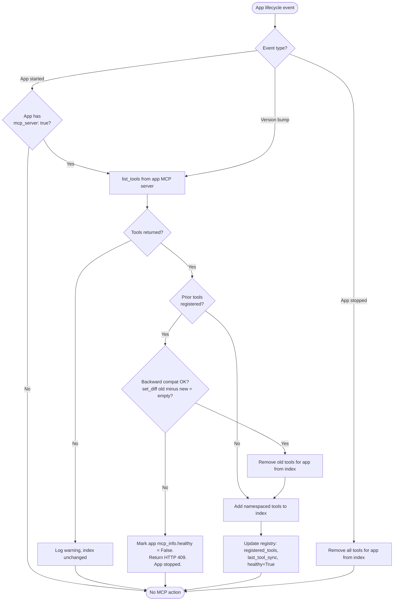

## 9. Redis Streams Activity Feed

How App messages on Redis Streams reach the dashboard activity feed. App-to-App messaging uses Redis Streams only (no pub/sub); the platform reads the same streams through the `AsyncStreamConsumer` in `src/latarnia/core/event_subscriber.py`.

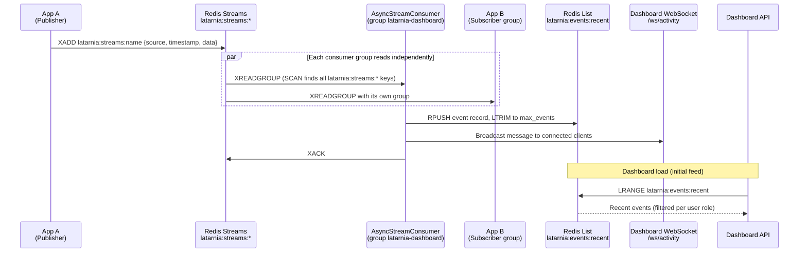

## 10. Role-Based App Tile Filtering and forward_auth Role Injection

How the dashboard filters app tiles server-side by role and how `/auth/verify` injects per-app role headers into every forwarded request. References cap-015, cap-016, flow-03 in P-0008.

```mermaid
sequenceDiagram
    participant Browser as User Browser
    participant Caddy
    participant AV as /auth/verify
    participant RS as RoleStore
    participant DB as latarnia_platform_{env}
    participant Dash as Dashboard /api/apps

    Note over Browser,Dash: Dashboard load — server-side tile filtering

    Browser->>Caddy: GET / [Cookie: latarnia_session=abc]
    Caddy->>AV: GET /auth/verify [catch-all: no X-Latarnia-App]
    AV->>DB: Validate session hash
    AV-->>Caddy: 200 [X-Latarnia-User: uid, X-Latarnia-Is-Super: false, X-Latarnia-App-Role: none] (no App named; role is full for a Superuser, none otherwise)
    Caddy->>Dash: GET /api/apps [X-Latarnia-User: uid, X-Latarnia-Is-Super: false]
    Dash->>RS: get_role(uid, app) for each app in registry
    Note over Dash: Filter: hide tiles where role = none<br/>Superuser bypasses filter (all apps visible, role = full)
    Dash-->>Browser: App list (only apps with role != none)

    Note over Browser,DB: Protected app request — role injected into proxy headers

    Browser->>Caddy: GET /apps/crm/dashboard [Cookie: ...]
    Caddy->>AV: GET /auth/verify [X-Latarnia-App: crm (set by Caddy), Cookie: ...]
    AV->>DB: Validate session
    AV->>RS: get_role(uid, "crm")
    alt role = none
        AV-->>Caddy: 403 "No access to this app" (no X-Latarnia-* headers)
        Caddy-->>Browser: 403 (passed through, no login redirect)
    else role != none
        AV-->>Caddy: 200 [X-Latarnia-User: uid, X-Latarnia-App-Role: webUI-med, X-Latarnia-Is-Super: false]
        Caddy->>Caddy: reverse_proxy re-sets the three X-Latarnia-* headers from verify's values and deletes X-Latarnia-App
    end
    Note right of Caddy: App receives role header;<br/>may adjust content accordingly
```

Role assignment is managed via `GET /api/auth/roles`, `GET /api/auth/roles/all` (superuser only), and `POST /api/auth/roles/{app}` (superuser only). The `RoleStore` (`src/latarnia/auth/roles.py`) reads and writes the `app_roles` table; default effective role for any unassigned (user, app) pair is `none`.

## 11. JWT Machine Token Issuance and API Call

How machine clients (scripts, AI agents) obtain and use long-lived JWT tokens to call the Latarnia REST API. References cap-019, cap-020, flow-04 in P-0008.

```mermaid
sequenceDiagram
    actor Operator
    participant Dashboard as Dashboard (API Tokens modal)
    participant Auth as /api/auth/tokens
    participant MTS as MachineTokenStore
    participant DB as latarnia_platform_{env}
    actor Client as Machine Client

    Note over Operator,DB: Token creation (one-time, any logged-in user; scope capped by the caller's own roles)

    Operator->>Dashboard: POST /api/auth/tokens {label, app_scope, expires_at}
    Dashboard->>Auth: (session cookie required; non-superuser scope checked against own roles)
    Auth->>MTS: create(label, app_scope, expires_at, granted_by)
    MTS->>MTS: Sign HS256 JWT {sub, iat, jti, exp, apps, super}
    MTS->>DB: INSERT machine_tokens (token_hash=SHA256(jwt), app_scope, ...)
    MTS-->>Auth: raw JWT string
    Auth-->>Dashboard: {token: "<raw_jwt>"}
    Dashboard-->>Operator: Show token once (plaintext never stored)

    Note over Client,DB: API call with Bearer token

    Client->>Client: GET /api/apps\nAuthorization: Bearer <jwt>
    Note over Client: JWTAuthMiddleware intercepts all /api/* requests

    Client->>Client: JWTAuthMiddleware.validate_jwt(token)
    Client->>DB: SELECT machine_tokens WHERE token_hash=SHA256(jwt) AND revoked_at IS NULL
    alt JWT invalid, expired, or revoked
        Client-->>Client: 401 Unauthorized
    else Valid
        Client->>Client: Extract app_scope from JWT claims
        Client-->>Client: 200 OK (response filtered to apps in scope)
    end

    Note over Operator,DB: Token management
    Operator->>Auth: GET /api/auth/tokens  →  list active tokens (no plaintext values)
    Operator->>Auth: DELETE /api/auth/tokens/{id}  →  set revoked_at = now()
```

`LATARNIA_JWT_SECRET` (from `secrets.env`) is the HS256 signing key. Any logged-in user may create a token. A superuser may grant any role. A non-superuser may grant on each App only a role no higher than their own role on that App (order: `ROLE_VALUES` in `src/latarnia/auth/roles.py`), and only a superuser may grant `full`; otherwise the request returns 403 and no token is created.

## 12. MCP Gateway Bearer Auth Flow

How an AI agent authenticates to the MCP Gateway with a Bearer JWT and receives a scoped tool list. References cap-021, flow-06 in P-0008.

```mermaid
sequenceDiagram
    actor Agent as AI Agent (e.g. Claude Desktop)
    participant Caddy
    participant GW as MCP Gateway /mcp/sse
    participant DB as latarnia_platform_{env}
    participant AppMCP as App MCP Server

    Agent->>Caddy: GET /mcp/sse\nAuthorization: Bearer <jwt>
    Note over Caddy: /mcp/* has NO forward_auth<br/>(gateway validates the JWT internally)
    Caddy->>GW: Proxy request (Bearer header forwarded)

    GW->>GW: Validate JWT signature + expiry
    GW->>DB: SELECT machine_tokens WHERE token_hash=SHA256(jwt) AND revoked_at IS NULL
    alt Invalid or revoked
        GW-->>Agent: 401 Unauthorized
    else Valid
        GW->>GW: Extract app_scope from JWT claims (ContextVar per connection)
        Note over GW: Tool list filtered to apps the token has access to
        GW->>AppMCP: Connect to app MCP server\nX-Latarnia-App-Role: <role_from_scope>
        GW-->>Agent: SSE stream open; aggregated tool list (scoped)

        Agent->>GW: call_tool(app.tool_name, args)
        GW->>GW: Check token has access to app
        GW->>AppMCP: Forward call with X-Latarnia-App-Role header
        AppMCP-->>GW: Tool result
        GW-->>Agent: Tool result
    end
```

The MCP Gateway uses a per-connection `ContextVar` to carry the token's app scope — this isolates concurrent connections. Websocket and `/mcp` traffic passes through `JWTAuthMiddleware` without session-cookie gating; JWT is the sole credential path for machine clients on `/mcp`.

## 13. Caddy Ingress — App Request Flow

How external browser requests reach Service App web UIs via Caddy (P-0008 Scope 1). The platform's Python web proxy was removed; Caddy is now the sole reverse proxy for app traffic. References P-0008 architecture.

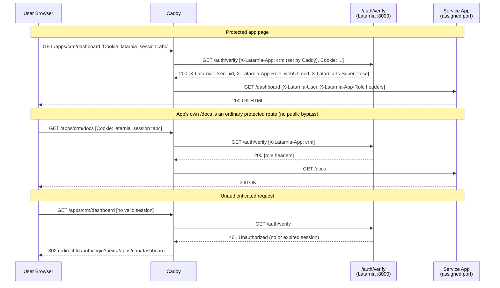

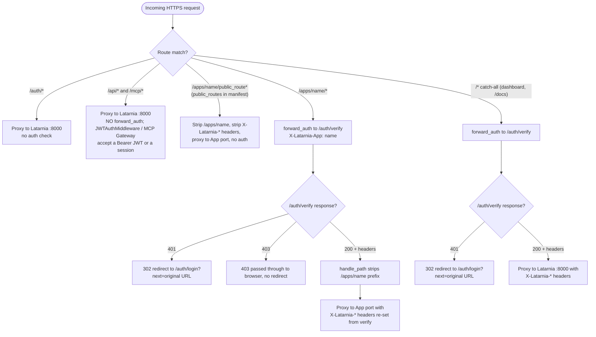

## 14. API Docs Flow (T-0020)

How a logged-in user (or a Machine Token holder) reads an App's UI API and App REST API docs. The docs live in the platform's `/docs` namespace, behind login; an App's own `/docs` is never published. See `src/latarnia/web/api_docs.py`.

The **App REST API** half documents a contract that is **planned, not yet available**: the public `/rest/{app}/` path it points to is not served by Caddy (pitch I-0002 is still open), so "Try it out" there does not reach the App. The UI API half is live.

```mermaid
sequenceDiagram
    participant Browser as User Browser
    participant C as Caddy
    participant L as Latarnia :8000<br/>(API Docs router)
    participant App as Service App<br/>(assigned port)

    Browser->>C: GET /docs/apps/crm/rest [Cookie: latarnia_session]
    C->>L: forward_auth /auth/verify, then proxy (catch-all)
    L->>L: role on crm != none? (403 if not, before existence check)
    L->>App: GET /openapi.json (App's internal port)
    App-->>L: full OpenAPI schema
    L->>L: keep /rest/ paths, prune unreferenced components,<br/>servers = /rest/crm
    L-->>Browser: Swagger UI page
    Browser->>C: GET /api/docs/apps/crm/rest [session or Bearer Machine Token]
    C->>L: proxy (no forward_auth; JWTAuthMiddleware authenticates)
    L->>App: GET /openapi.json
    L-->>Browser: split OpenAPI schema (UI API: /api/ half, App REST API: /rest/ half)
```

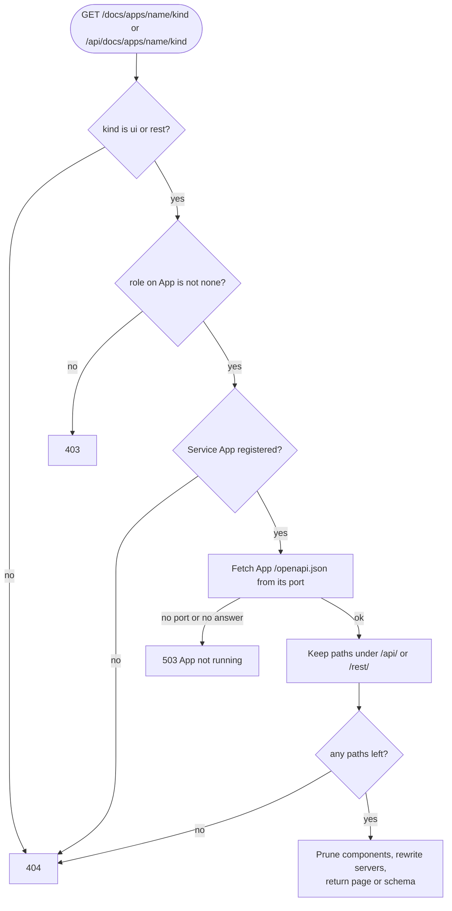
